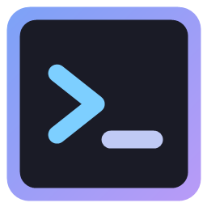

<p align="center">
  
</p>

<h1 align="center">Kabuk</h1>

<p align="center">
  Bölünmüş panelli, temalı, yapay zekâ araçlarıyla rahat çalışmak için yapılmış bir Windows terminali.
</p>

<p align="center">
  <b>Türkçe</b> · <a href="README.en.md">English</a>
</p>

<p align="center">
  <a href="https://github.com/ysft1rt-art/kabuk/releases/latest"><b>İndir (Windows 10/11, 64 bit)</b></a>
</p>

---

## İçindekiler

- [Özellikler](#özellikler)
- [Kurulum](#kurulum)
- [Güncellemeler](#güncellemeler)
- [Kullanım](#kullanım)
- [Kısayollar](#kısayollar)
- [Sağ tık menüsü: "Kabuk ile aç"](#sağ-tık-menüsü-kabuk-ile-aç)
- [Bildirimler (Claude Code, Codex)](#bildirimler-claude-code-codex)
- [Ayarlar](#ayarlar)
- [Kaynaktan derleme](#kaynaktan-derleme)
- [Yeni sürüm yayınlama](#yeni-sürüm-yayınlama)
- [Proje yapısı](#proje-yapısı)
- [Lisans](#lisans)

## Özellikler

- **Bölünmüş paneller:** Ekranı sağa, sola, yukarı ve aşağı istediğin kadar böl; panel kenarlarını sürükleyerek boyutlandır.
- **Sekmeler:** Sürükleyerek sırala, Ctrl+Tab ile aralarında gez.
- **Gizli terminaller:** Bir paneli kapatmadan gizle; arka planda çalışmaya devam eder, üst çubuktaki "Gizli" düğmesinden geri getirilir.
- **Paneli büyütme:** Bölünmüş ekranda `Ctrl+Shift+Z` ile seçili panel bütün sekmeyi kaplar, aynı tuşla eski düzene döner. Diğer paneller arkada çalışmaya devam eder.
- **Dosya sürükle-bırak:** Gezgin'den bir dosyayı ya da klasörü panele sürükle; yolu oraya yazılır. Yol, paneldeki kabuğa göre (PowerShell, cmd, Git Bash, WSL) doğru tırnaklanır; Claude Code gibi bir program çalışıyorsa olduğu gibi yazılır.
- **Ctrl+Z ile geri al:** Yanlışlıkla açtığın yeni paneli, içine bir şey yazmadıysan Ctrl+Z ile kapatırsın.
- **Terminalde arama:** `Ctrl+F` ile çıktının içinde ara; bütün eşleşmeler boyanır, kaçıncısında olduğun görünür. Enter yukarı, Shift+Enter aşağı gider.
- **26 tema:** Her birinin koyu ve açık hali var (Kar, Catppuccin, Nord, Rosé Pine, Kanagawa, Solarized, One Dark / Light ve daha fazlası). Koyu/açık seçimi Windows'a uyabilir.
- **Buzlu cam efekti:** Pencerenin arkası bulanık ve yarı saydam görünür; yoğunluğu ayarlanabilir.
- **Yazı tipleri:** JetBrains Mono, Geist Mono, Fira Code ve Source Code Pro uygulamayla birlikte gelir; bilgisayarındaki Cascadia gibi yazı tipleri de seçilebilir.
- **Kabuklar:** PowerShell 7, Windows PowerShell, Komut İstemi, Git Bash otomatik bulunur; Python, Node, SSH, WSL gibi istediğin programı da kabuk olarak ekleyebilirsin.
- **Yapay zekâ araçları için:** Sağ tık menüsünden bir klasörü doğrudan Claude Code, Codex, Gemini CLI ve diğer araçlarla aç. Araç işini bitirince ya da onay beklerken haber verir.
- **Hızlı ve düzgün çizim:** Terminaller WebGL ile çizilir; Claude Code maskotu gibi blok karakterleri boşluksuz görünür.
- **Komut önerileri ve eğlence modu:** Yeni terminalde, bir şey yazana kadar boş satırda örnek komutlar akar. Eğlence modunda `kedi`, `köpek`, `kar` gibi kelimelerle küçük animasyonlar oynar.
- **Türkçe ve İngilizce:** Arayüz dili Windows'un diline göre seçilir, Ayarlar'dan değiştirilebilir.
- **Otomatik güncelleme:** Yeni sürüm çıkınca kendisi bulur, arka planda indirir ve tek tıkla kurar.

## Kurulum

1. [Releases](https://github.com/ysft1rt-art/kabuk/releases/latest) sayfasından `Kabuk-Kurulum-<sürüm>.exe` dosyasını indir.
2. Çalıştır. Kurulum tek tıklıktır, yönetici izni istemez; Kabuk bu kullanıcı için `%LOCALAPPDATA%\Programs\kabuk` klasörüne kurulur ve Başlat menüsüne ve masaüstüne kısayol eklenir.
3. Kurulum dosyası dijital olarak imzalı olmadığı için Windows ilk çalıştırmada **"Windows bilgisayarınızı korudu"** diyebilir. **Ek bilgi → Yine de çalıştır** ile devam edebilirsin.

Kaldırmak için: Windows Ayarları → Uygulamalar → Yüklü uygulamalar → Kabuk → Kaldır. Kaldırınca sağ tık menüsündeki "Kabuk ile aç" da silinir. Ayarların `%APPDATA%\Kabuk` klasöründe kalır.

## Güncellemeler

- Kabuk açıkken, açıldıktan kısa süre sonra ve sonra birkaç saatte bir GitHub'da yeni sürüm var mı diye bakar.
- Yeni sürüm bulursa arka planda indirir. İndirirken üst çubukta yüzdeyi gösteren bir düğme belirir; indirme bitince düğme **Güncelle** olur.
- Düğmeye basınca açılan pencerede yenilikleri görürsün. **Yeniden başlat ve güncelle** dersen Kabuk kapanır, yeni sürüm kurulur ve Kabuk kendiliğinden yeniden açılır.
- Hemen istemezsen bir şey yapman gerekmez: Kabuk'u kapattığında yeni sürüm kendiliğinden kurulur.
- **Ayarlar → Güncellemeler** bölümünden elle denetleyebilir ya da otomatik denetlemeyi kapatabilirsin.

## Kullanım

- **Yeni sekme:** Üst çubuktaki `+` düğmesi. Yanındaki ok farklı bir kabukla açar ve varsayılan kabuğu seçtirir.
- **Ekranı bölmek:** Üst çubuktaki bölme düğmeleri ya da `Alt` + ok tuşları. Bölünen panel, bulunduğun klasörde açılır.
- **Kopyala / yapıştır:** Seçim varken sağ tık kopyalar, yokken yapıştırır. `Ctrl+C` seçim varsa kopyalar, yoksa çalışan programı durdurur. `Ctrl+V` yapıştırır.
- **Bağlantılar:** Terminalde görünen adreslere tıklayınca tarayıcında açılır. Programların adresini göstermeden koyduğu bağlantılarda önce adres gösterilir, onaylarsan açılır. Kabuk'un içinde hiçbir zaman web sayfası açılmaz.
- **Yazı boyutu:** `Ctrl` + fare tekerleği ya da `Ctrl +` / `Ctrl -`.

## Kısayollar

Bütün kısayollar **Ayarlar → Kısayollar** bölümünden değiştirilebilir; bir işe ikinci bir kısayol da eklenebilir. Üst çubuktaki `?` düğmesi güncel listeyi gösterir.

| İş | Varsayılan |
|---|---|
| Sağa / aşağıya terminal aç | `Alt+→` / `Alt+↓` (ya da `Ctrl+Shift+D` / `Ctrl+Shift+E`) |
| Sola / yukarıya terminal aç | `Alt+←` / `Alt+↑` |
| Yeni açılan terminali geri al | `Ctrl+Z` (o panele henüz bir şey yazılmadıysa) |
| Paneller arasında gezin | `Ctrl+Alt` + ok tuşları |
| Yeni sekme | `Ctrl+Shift+T` |
| Paneli kapat | `Ctrl+Shift+W` |
| Paneli gizle | `Ctrl+Shift+H` |
| Paneli büyüt / eski boyutuna döndür | `Ctrl+Shift+Z` |
| Sonraki / önceki sekme | `Ctrl+Tab` / `Ctrl+Shift+Tab` |
| Ayarlar | `Ctrl+,` |
| Kopyala | `Ctrl+Shift+C` |
| Terminalde ara | `Ctrl+F` |
| Yapıştır | `Ctrl+V` / `Ctrl+Shift+V` |
| Yazıyı büyüt / küçült / sıfırla | `Ctrl+=` / `Ctrl+-` / `Ctrl+0` |

## Sağ tık menüsü: "Kabuk ile aç"

Dosya Gezgini'nde bir klasöre (ya da açık klasörün boş bir yerine) sağ tıklayınca **Kabuk ile aç** çıkar.

- Bilgisayarında kurulu bir yapay zekâ komut satırı aracı yoksa tek satırdır ve terminali o klasörde açar.
- Kurulu araçlar varsa alt menü olur: **Terminal** ve bulunan araçlar. Araca tıklayınca Kabuk o klasörde açılır ve aracı başlatır.
- Tanınan araçlar: Claude Code, Codex, Gemini CLI, OpenCode, Pi, GitHub Copilot CLI, Cursor CLI, Qwen Code, Amp, Crush, Factory Droid, Cline, Kimi CLI, Kiro CLI, Auggie, Goose, Aider. Liste [`contextmenu/clis.txt`](contextmenu/clis.txt) dosyasındadır.
- Kabuk zaten açıksa yeni pencere açılmaz, açık pencerede yeni sekme açılır.

**Windows 11'in kısa menüsü:** Menü önce "Diğer seçenekleri göster" altında görünür. Kısa (yeni) menüde de görünmesi için **Ayarlar → Başlangıç → "Windows 11 menüsüne ekle"** düğmesine bir kez bas. Windows bir kez yönetici onayı ister: Kabuk'un menü eklentisi kendi imzasıyla imzalıdır ve Windows'un bu imzaya güvenmesi gerekir. Bu imzanın gizli anahtarı imzalandıktan hemen sonra silinir; bu imzayla başka hiçbir şey onaylanamaz.

Menüyü istemezsen **Ayarlar → Başlangıç** bölümünden kapatabilirsin.

## Bildirimler (Claude Code, Codex)

Bir program dikkatini istediğinde (iş bitti, onay bekleniyor) Kabuk haber verir:

- O terminale zaten bakıyorsan hiçbir şey olmaz.
- Aynı sekmede başka bir paneldeyse panelin çerçevesi yanıp söner.
- Başka sekmedeyse sekmede bir nokta belirir; Kabuk arkadaysa Windows bildirimi çıkar ve görev çubuğundaki simge yanar. Bildirime tıklayınca o terminale gidilir.

Programların bildirim göndermesi için bir kez ayar gerekir:

- **Claude Code:** Claude Code'da `/config` yaz, **Notifications** satırını **Ghostty** yap.
- **Codex:** Kullanıcı klasöründeki `.codex\config.toml` dosyasına şunu ekle:

  ```toml
  [tui]
  notifications = true
  notification_method = "osc9"
  ```

Windows bildirimi çıkmıyorsa Windows Ayarları → Sistem → Bildirimler'de Kabuk'un açık olduğuna bak. **Ayarlar → Bildirimler** bölümünde deneme bildirimi gönderebilirsin.

## Ayarlar

`Ctrl+,` ya da üst çubuktaki dişli düğmesi. Değişiklikler hemen uygulanır.

| Bölüm | Neler var |
|---|---|
| Başlangıç | Varsayılan kabuk, başlangıç klasörü, bölünen panelin aynı klasörde açılması, pencerenin açılış boyutu, kapatırken onay, sağ tık menüsü |
| Görünüm | Dil, tema, koyu/açık, saf siyah zemin, buzlu cam ve yoğunluğu, eğlence modu, komut önerileri |
| Yazı tipi | Yazı tipi, kalınlık, boyut |
| Terminal | İmleç şekli ve yanıp sönmesi, satır aralığı, geçmiş uzunluğu, seçince kopyalama, sağ tıkla kopyala/yapıştır |
| Bildirimler | Bildirimler, Windows bildirimi, görev çubuğunda yanıp sönme, zil sinyali |
| Kısayollar | Bütün kısayolları değiştirme |
| Kabuklar | Bulunan kabuklar, yeni kabuk ekleme |
| Güncellemeler | Sürüm, elle denetleme, otomatik denetleme |

## Kaynaktan derleme

Gerekenler: [Node.js](https://nodejs.org/) 22 veya üstü, Windows 10/11.

```bash
git clone https://github.com/ysft1rt-art/kabuk.git
cd kabuk
npm install
npm start
```

Kurulum dosyası üretmek için:

```bash
npm run dist
```

Çıktı `dist\Kabuk-Kurulum-<sürüm>.exe` olur. Sağ tık menüsü eklentisi (`contextmenu\KabukMenu.dll` ve paketleri) depoda hazır gelir; yalnızca C++ kodunu değiştirirsen `contextmenu\build.ps1` ile yeniden derlemen gerekir (Visual Studio C++ araçları ve Windows SDK gerekir).

## Yeni sürüm yayınlama

1. `package.json` içindeki `version` değerini artır (örn. `1.0.1`) ve commit'le.
2. Aynı sürümle bir etiket oluşturup gönder:

   ```bash
   git tag v1.0.1
   git push origin main v1.0.1
   ```

3. GitHub Actions ([`.github/workflows/release.yml`](.github/workflows/release.yml)) kurulum dosyasını Windows'ta derler ve Releases sayfasına koyar. Kurulu Kabuk'lar yeni sürümü birkaç saat içinde kendiliğinden bulur.

## Proje yapısı

| Yol | Ne |
|---|---|
| `main.js` | Ana süreç: pencere, terminaller (node-pty), bildirimler, sağ tık menüsü kurulumu |
| `updater.js` | Otomatik güncelleme (electron-updater, GitHub Releases) |
| `preload.js` | Arayüzün ana süreçle konuştuğu güvenli köprü |
| `renderer/` | Arayüz: sekmeler, paneller, ayarlar, temalar, kısayollar, çeviriler |
| `contextmenu/` | Windows sağ tık menüsü eklentisi (C++), menü paketleri ve araç listesi |
| `build/installer.nsh` | Kurulum programına eklenen adımlar |
| `assets/` | Uygulama simgeleri |

Kullanılanlar: [Electron](https://www.electronjs.org/), [xterm.js](https://xtermjs.org/), [node-pty](https://github.com/microsoft/node-pty), [electron-builder](https://www.electron.build/).

## Lisans

[MIT](LICENSE)
